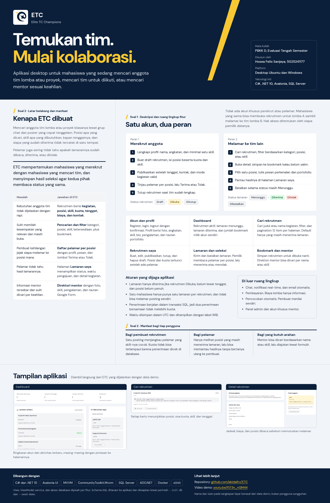

# Week ETS - ETC (Elite TC Champions)

**Nama**: Hosea Felix Sanjaya  
**NRP**: 5025241177  
**Kelas**: PBKK D


| | |
| :-- | :-- |
| PRD | [PRD.pdf](https://github.com/abidalfrz/ETC/blob/main/PRD.pdf) |
| Repository | [github.com/abidalfrz/ETC](https://github.com/abidalfrz/ETC) |
| Video Demo | [youtu.be/fST3n_nGM44](https://youtu.be/fST3n_nGM44) |

## Video Demo

[](https://youtu.be/fST3n_nGM44)

## Jawaban Soal

### Soal 1. Deskripsi dan ruang lingkup fitur

ETC adalah aplikasi desktop berbasis Avalonia untuk mempertemukan mahasiswa yang membutuhkan anggota tim lomba atau proyek dengan mahasiswa yang sedang mencari tim. Aplikasi ini juga menyediakan direktori mentor yang bisa dicari berdasarkan keahlian.

Tidak ada akun khusus perekrut atau pelamar. Satu akun mahasiswa bisa membuka rekrutmen untuk lomba A sambil melamar ke tim lomba B. Hak akses ditentukan oleh siapa pemilik datanya, dan pengecekannya dilakukan di service, bukan hanya dengan menyembunyikan tombol.

**Alur sebagai pembuat rekrutmen**

1. Lengkapi profil: nama, angkatan, dan minimal satu skill.
2. Buat draft rekrutmen, lalu isi posisi beserta kuota dan skill yang dibutuhkan.
3. Publikasikan setelah tenggat, kontak, dan mode kegiatan valid.
4. Tinjau pelamar per posisi, lalu terima atau tolak.
5. Tutup rekrutmen saat tim sudah lengkap.

Status rekrutmen: `Draft` → `Dibuka` → `Ditutup`.

**Alur sebagai pelamar**

1. Cari rekrutmen dan filter berdasarkan kategori, posisi, skill, atau ketersediaan.
2. Buka detail, simpan ke bookmark jika belum yakin.
3. Pilih satu posisi, tulis pesan perkenalan dan tautan portofolio.
4. Pantau hasilnya di halaman Lamaran saya.
5. Batalkan lamaran selama statusnya masih Menunggu.

Status lamaran: `Menunggu` → `Diterima`, `Ditolak`, atau `Dibatalkan`.

**Ruang lingkup fitur**

| Area | Isi |
| :-- | :-- |
| Akun dan profil | Onboarding, register, login, logout dengan konfirmasi, profil berisi foto, angkatan, skill, bio, pengalaman, dan tautan portofolio. Profil publik tidak menampilkan email login. |
| Dashboard | Jumlah rekrutmen aktif, lamaran menunggu, lamaran diterima, dan bookmark milik akun sendiri, ditambah daftar aktivitas terbaru. |
| Cari rekrutmen | Pencarian judul atau nama kegiatan, filter kategori, posisi, skill, dan ketersediaan, pagination 12 item per halaman. Filter awal hanya menampilkan rekrutmen yang masih menerima lamaran. |
| Rekrutmen saya | Membuat, mengedit, mempublikasikan, menutup, dan menghapus draft. Posisi, skill, dan kuota terkunci setelah ada pelamar. |
| Lamaran dan seleksi | Mengirim dan membatalkan lamaran. Pemilik melihat pelamar per posisi beserta profil dan pesannya, lalu menerima atau menolak. |
| Bookmark | Menyimpan rekrutmen untuk dibuka nanti. Rekrutmen yang sudah ditutup tetap bisa dibaca dari bookmark. |
| Direktori mentor | Kartu mentor dengan foto, angkatan, fokus, skill, dan pengalaman. Bisa dicari per nama atau skill. Tombol *Butuh mentor?* membuka Google Form di browser. |
| Setup | Perintah `--init-db` untuk menyiapkan schema dan `--seed-demo` untuk data demo, sehingga aplikasi bisa dijalankan di komputer lain. |

**Aturan yang dijaga aplikasi**

- Lamaran hanya diterima jika rekrutmen berstatus Dibuka, belum lewat tenggat, dan posisi belum penuh.
- Satu mahasiswa hanya punya satu lamaran per rekrutmen, dan tidak bisa melamar rekrutmen miliknya sendiri.
- Penerimaan pelamar berjalan dalam transaksi SQL, jadi dua penerimaan yang terjadi bersamaan tidak bisa melebihi kuota.
- Waktu disimpan dalam UTC dan ditampilkan dengan label WIB.

**Di luar ruang lingkup:** chat, notifikasi real-time, pembayaran (biaya lomba hanya informasi), pencocokan otomatis berbasis skor, panel admin, akun khusus mentor, dan mode gelap.

### Soal 2. Latar belakang dan manfaat

**Latar belakang**

Mencari anggota tim lomba atau proyek biasanya dilakukan lewat grup chat dan poster yang cepat tenggelam oleh pesan lain. Informasi penting seperti posisi apa yang dicari, skill yang dibutuhkan, tenggat pendaftaran, dan siapa yang sudah diterima tidak tercatat di satu tempat. Dari sisi pelamar, sering tidak jelas apakah lamarannya sudah dibaca, diterima, atau ditolak.

ETC dibuat untuk menyatukan proses itu: pembuat rekrutmen menjelaskan kebutuhannya secara terstruktur, pelamar memilih posisi yang cocok, dan hasil seleksi tersimpan sehingga kedua pihak membaca status yang sama.

| Masalah | Jawaban di ETC |
| :-- | :-- |
| Kebutuhan anggota tim tidak dijelaskan dengan rapi. | Rekrutmen berisi kegiatan, posisi, skill, kuota, tenggat, biaya, dan kontak. |
| Sulit memilah kesempatan yang relevan dan masih buka. | Pencarian, filter, detail posisi, bookmark, dan alasan jika pendaftaran tidak tersedia. |
| Pembuat kehilangan jejak siapa melamar ke posisi mana. | Daftar pelamar per posisi dengan profil, pesan, dan keputusan terima atau tolak. |
| Pelamar tidak tahu hasil lamarannya. | Halaman Lamaran saya menampilkan status, waktu pengajuan, dan detail kegiatan. |
| Informasi mentor tersebar dan sulit dicari per keahlian. | Direktori mentor dengan foto, skill, pengalaman, dan tautan Google Form. |

**Manfaat**

- **Bagi pembuat rekrutmen:** satu posting menjangkau pelamar dengan skill yang sesuai, pelamar terkumpul per posisi, dan kuota tidak bisa terlampaui karena penerimaan dicek di database.
- **Bagi pelamar:** hanya melihat posisi yang masih menerima lamaran, bisa menyimpan kandidat lomba ke bookmark, dan bisa memantau hasil lamaran tanpa harus bertanya ulang ke pembuat.
- **Bagi mahasiswa yang butuh arahan:** mentor bisa dicari berdasarkan nama atau skill, lalu diajukan lewat formulir.
- **Bagi pengembangan berikutnya:** data rekrutmen, lamaran, dan mentor tersimpan di SQL Server dengan aturan bisnis yang jelas, sehingga fitur seperti notifikasi atau chat bisa ditambahkan di atasnya.

### Soal 3. Poster infografis

Poster satu halaman tersedia dalam dua bentuk:

- [poster-etc.html](./poster-etc.html): versi HTML. Buka di browser, lalu cetak (Ctrl+P) untuk mendapatkan satu lembar A3. Tampilannya juga menyesuaikan layar HP.
- [img/poster-etc.png](./img/poster-etc.png): versi gambar, ditampilkan di bawah.

Tangkapan layar di poster diambil langsung dari aplikasi ETC yang dijalankan dengan data demo. Warna, font DM Sans, dan logo mengikuti aset aplikasi.



## 1. Tentang Project
ETC (Elite TC Champions) adalah aplikasi desktop untuk membantu mahasiswa mencari anggota tim, menemukan rekrutmen lomba atau proyek, dan mencari mentor sesuai keahlian. Satu akun bisa membuat rekrutmen sendiri sekaligus melamar ke rekrutmen mahasiswa lain.

Aplikasi dibuat dengan C#, .NET 10, dan Avalonia UI. Target utamanya Ubuntu, dan Windows sebagai target tambahan. Data disimpan di SQL Server dan diakses lewat ADO.NET dengan paket `Microsoft.Data.SqlClient`.

## 2. Fitur Utama
- Registrasi, login, logout, dan pengelolaan profil mahasiswa
- Profil berisi skill, pengalaman, foto, bio, dan tautan portofolio
- Dashboard berisi statistik pribadi
- Membuat, mengedit, mempublikasikan, dan menutup rekrutmen
- Rekrutmen berisi posisi, kuota, kategori lomba atau proyek, jadwal, biaya, dan kontak
- Pencarian, filter, pagination, dan bookmark rekrutmen
- Mengirim dan membatalkan lamaran, lalu pemilik rekrutmen menerima atau menolaknya
- Halaman Lamaran saya dan daftar pelamar untuk rekrutmen sendiri
- Direktori mentor yang bisa dicari berdasarkan nama atau keahlian
- Tombol ke Google Form untuk pengajuan mentoring
- Validasi input, pembatasan akses berdasarkan pemilik data, dan validasi kuota
- Schema dan data demo SQL Server yang disiapkan lewat perintah CLI
- Tampilan memakai Fluent theme dari Avalonia

## 3. Teknologi dan Arsitektur

| Komponen | Teknologi |
| :-- | :-- |
| Bahasa dan runtime | C#, .NET 10 |
| Antarmuka desktop | Avalonia UI |
| Pola aplikasi | MVVM dan data binding |
| Command | CommunityToolkit.Mvvm |
| Database | Microsoft SQL Server |
| Akses data | ADO.NET dan `Microsoft.Data.SqlClient` |
| Infrastruktur lokal | Docker |
| Pengujian | Unit test dan integration test .NET |

Tampilan, state, aturan bisnis, dan akses database dipisah. ViewModel menangani state dan command, service menjalankan proses bisnis, dan Infrastructure mengurus koneksi serta inisialisasi SQL Server.

## 4. Struktur Project

```
ETC/
├── database/
│   ├── 001-schema.sql
│   ├── 002-catalog.sql
│   └── 003-mentor-directory.sql
├── src/Etc.Desktop/
│   ├── Features/              # Akun, profil, dashboard, rekrutmen, lamaran, bookmark, mentor
│   ├── Infrastructure/        # Koneksi dan inisialisasi database
│   ├── Shared/                # Komponen dan state bersama
│   ├── Styles/                # Token dan style Avalonia
│   ├── Assets/                # Foto mentor, ikon, font, dan data pendukung
│   ├── App.axaml
│   ├── MainWindow.axaml
│   └── Program.cs
├── tests/
│   ├── Etc.UnitTests/
│   └── Etc.IntegrationTests/
├── tools/Etc.RenderChecks/
├── Etc.slnx
├── PRD.pdf
├── README.md
├── global.json
└── Directory.Build.props
```

Database utama berisi tabel mahasiswa, skill, rekrutmen, posisi, lamaran, bookmark, dan mentor. File SQL di folder `database/` ditanam ke aplikasi saat build.

## 5. Cara Menjalankan

### Prasyarat
- SDK .NET 10 sesuai `global.json`
- Docker Engine di Ubuntu, atau Docker Desktop di Windows
- Sesi desktop untuk menampilkan window Avalonia

Cek instalasi:

```bash
dotnet --version
docker version
```

### 5.1 Jalankan SQL Server
Contoh di bawah memakai password sementara. Kalau passwordnya diganti, pakai password yang sama di connection string.

```bash
docker run --name etc-sql \
  --env ACCEPT_EULA=Y \
  --env MSSQL_PID=Developer \
  --env MSSQL_SA_PASSWORD='Etc-Sql!2026Aa' \
  --publish 127.0.0.1:1433:1433 \
  --volume etc-sql-data:/var/opt/mssql \
  --detach mcr.microsoft.com/mssql/server:2022-latest
```

Buat database `ETC_Demo`:

```bash
docker exec -it etc-sql /opt/mssql-tools18/bin/sqlcmd \
  -S localhost -U sa -C -b \
  -Q "IF DB_ID(N'ETC_Demo') IS NULL CREATE DATABASE ETC_Demo;"
```

### 5.2 Atur Koneksi dan Siapkan Aplikasi
Di Ubuntu atau Bash:

```bash
export ETC_CONNECTION_STRING='Server=127.0.0.1,1433;Database=ETC_Demo;User ID=sa;Password=Etc-Sql!2026Aa;Encrypt=true;TrustServerCertificate=true'

dotnet restore
dotnet build
dotnet run --project src/Etc.Desktop -- --init-db
dotnet run --project src/Etc.Desktop -- --seed-demo
```

Di PowerShell, atur connection string dulu sebelum menjalankan perintah `dotnet` yang sama:

```powershell
$env:ETC_CONNECTION_STRING = 'Server=127.0.0.1,1433;Database=ETC_Demo;User ID=sa;Password=Etc-Sql!2026Aa;Encrypt=true;TrustServerCertificate=true'
```

### 5.3 Buka Aplikasi

```bash
dotnet run --project src/Etc.Desktop
```

Seeder membuat akun demo dengan password `Etc-Demo!2026`. Password ini bisa diganti lewat environment variable `ETC_DEMO_PASSWORD` saat menjalankan seed.

Untuk menjalankan lagi setelah setup selesai:

```bash
docker start etc-sql
dotnet run --project src/Etc.Desktop
```

Environment variable hanya berlaku di terminal yang sedang dipakai, jadi atur ulang `ETC_CONNECTION_STRING` setiap membuka terminal baru.

## 6. Pengujian
Unit test:

```bash
dotnet test tests/Etc.UnitTests
```

Integration test butuh `ETC_TEST_CONNECTION_STRING` yang mengarah ke database pengujian terpisah, bukan `ETC_Demo`:

```bash
dotnet test Etc.slnx
```

## 7. Batasan
ETC adalah aplikasi demonstrasi desktop. Aplikasi ini tidak punya chat, notifikasi real-time, pembayaran, panel admin, deployment publik, atau sinkronisasi offline. Data disimpan di SQL Server lokal, dan sesi login berakhir saat aplikasi ditutup.
